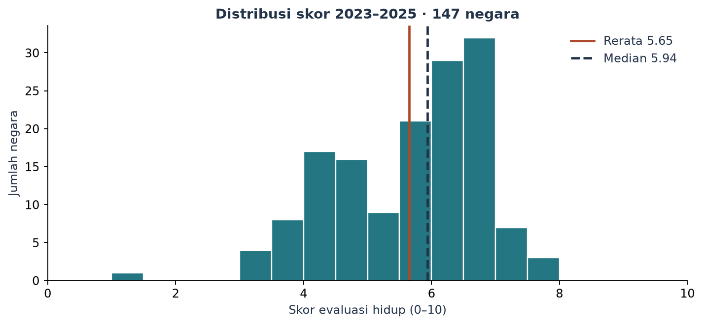
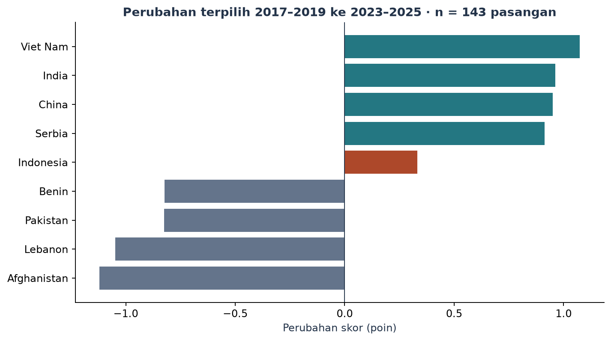

# World Happiness Analysis — WHR 2026

**Surya Winaldi Yakin · Portofolio Data Analyst**

Analisis deskriptif evaluasi hidup lintas negara: distribusi skor 2023–2025, perubahan skor pada periode yang sama, sensitivitas cakupan negara, dan audit dekomposisi resmi World Happiness Report.

## Pertanyaan analisis

1. Bagaimana distribusi skor 2023–2025 dan posisi Indonesia bersama interval kepercayaannya?
2. Bagaimana skor berubah dari 2017–2019 ke 2023–2025 pada negara yang tercakup di kedua periode?
3. Apakah ringkasan perubahan bertahan pada panel seimbang dan periode pembanding lain?
4. Bagaimana tujuh komponen dekomposisi merekonstruksi skor terbitan WHR?

## Hasil utama

Angka berikut telah dicocokkan dengan eksekusi ulang notebook dari workbook yang checksum-nya terverifikasi, serta laporan revisi:

- Potret 2023–2025: 147 negara, rerata 5,650 dan median 5,937.
- Perubahan 2017–2019 ke 2023–2025: 143 negara berpasangan; rerata +0,102 poin, dengan 90 negara naik dan 53 turun.
- Indonesia: peringkat 87, skor 5,617, IK 95% 5,517–5,718; perubahan +0,331 poin dari 2017–2019.
- Panel seimbang mencakup 129 negara. Ringkasan antarnegara memberi bobot yang sama pada setiap negara.
- Pada 1.013 baris dengan komponen lengkap, selisih absolut maksimum skor terhadap jumlah tujuh komponen adalah 0,003 poin.





## Notebook dan laporan

- [Notebook revisi](notebooks/01_world_happiness_analysis.ipynb)
- [Laporan PDF](reports/Laporan_World_Happiness_Analysis.pdf)
- [Laporan Word](reports/Laporan_World_Happiness_Analysis.docx)
- [Sumber data, checksum, dan kamus kolom](data/README.md)

Grafik di `visuals/` berasal dari eksekusi ulang notebook menggunakan workbook terverifikasi. Tabel CSV dan `metrics.json` dibuat dalam `outputs/` ketika notebook dijalankan. Notebook dan laporan unggahan dipertahankan tanpa perubahan isi.

## Cara menjalankan

Python 3.12 disarankan. Dari akar repository:

```bash
python -m venv .venv
source .venv/bin/activate
# Windows: .venv\Scripts\activate
python -m pip install -r requirements.txt
jupyter notebook notebooks/01_world_happiness_analysis.ipynb
```

Pilih **Run All**. Notebook mendukung direktori kerja akar repository maupun `notebooks/`.

Workbook `WHR26_Data_Figure_2.1.xlsx` sudah disertakan di `data/raw/`; CSV versi awal dipertahankan untuk audit. Notebook memeriksa SHA-256 workbook sebelum membaca data. Eksekusi analisis tidak memerlukan unduhan data; koneksi ke `files.worldhappiness.report` diperlukan hanya jika workbook lokal dihapus.

**Status verifikasi (6 November 2026):** seluruh 7 sel kode berhasil dieksekusi dari awal menggunakan workbook lokal dengan SHA-256 yang cocok. Semua assertion internal lulus. Pemeriksaan hasil mengonfirmasi 2.116 baris, 147 negara pada potret terbaru, 143 negara berpasangan (90 naik dan 53 turun), 129 negara panel seimbang, serta 6 grafik. Rerata perubahan +0,102, perubahan Indonesia +0,331, dan galat rekonstruksi maksimum 0,003 poin sesuai laporan. Eksekusi dilakukan dalam salinan sementara agar notebook unggahan tetap utuh.

## Keputusan metodologis

Label tahun menunjukkan akhir jendela tiga tahun; label 2025 mewakili 2023–2025. Label 2013 tidak tersedia dan celahnya dipertahankan pada grafik. Analisis membandingkan panel tersedia, panel seimbang, dan negara berpasangan. Nilai hilang dipertahankan sebagai NA.

Enam kolom `Explained by` merupakan kontribusi hasil model WHR, bukan indikator mentah. Karena kontribusi beserta Dystopia + residual hampir menjumlah ke skor, regresi ulang versi awal tidak digunakan sebagai bukti pengaruh faktor. Perubahan skor dilaporkan secara deskriptif, tanpa klaim kausal atau uji tren sederhana pada jendela survei yang bertumpang tindih.

IK skor individual tidak langsung menyediakan IK selisih antarperiode. Panel seimbang dapat menyeleksi negara dengan survei lebih konsisten; ringkasan ini bukan rerata berbobot populasi dan tidak menjelaskan variasi antarindividu.

## Struktur

```text
notebooks/       notebook revisi dengan keluaran tersimpan
reports/         laporan PDF dan Word
visuals/         enam grafik dari notebook revisi
outputs/         tabel dan metrics.json saat dijalankan (diabaikan Git)
data/            petunjuk data dan CSV input lama untuk audit
archive/legacy/  notebook, grafik, dan CSV hasil versi awal
```

Arsip versi awal dipertahankan untuk penelusuran; klaim dan hasilnya telah digantikan revisi ini.

## Sumber

- [World Happiness Report 2026](https://www.worldhappiness.report/ed/2026/)
- [Data sharing](https://www.worldhappiness.report/data-sharing/)
- [Workbook resmi](https://files.worldhappiness.report/WHR26_Data_Figure_2.1.xlsx)
- [Lampiran statistik](https://files.worldhappiness.report/WHR26_Statistical_Appendix.pdf)
